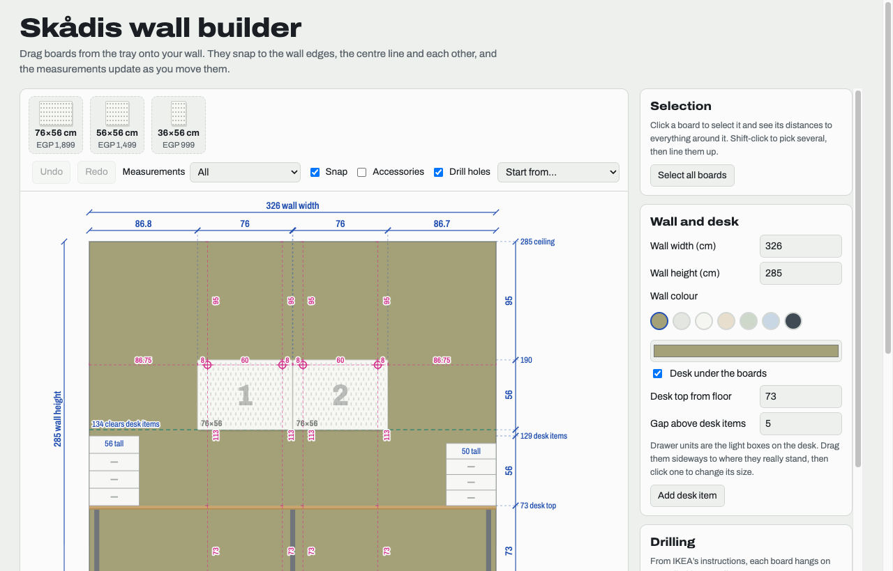

# Skådis wall builder

Plan an IKEA Skådis pegboard wall in your browser. Drag boards onto a drawing of your wall, let them snap into place, and get exact drill marks plus a shopping list.

**Live** https://yharby.github.io/wall-board-planner/



## What it does

- Drag 76×56, 56×56 and 36×56 boards from the tray, or tap a tile to add one next to the others
- Boards snap to the wall edges, the centre line and each other, with the 5 mm joint IKEA recommends
- Dimension chains show every gap, every board edge and every level from the floor
- Drill marks give the left and height position of each wall screw, also listed in a table
- A desk and drawer units can be drawn under the boards, with a warning when a board would hit them
- Shopping list with prices and product links
- Works on phones and tablets. Labels keep the same screen size and the wall scales to fit
- Undo and redo, keyboard shortcuts, and your layout is saved in the browser

## Make it your own

There is no build step and no dependencies. Four files do everything.

| File | What it holds |
| --- | --- |
| `config.js` | Board sizes, prices, currency, finishes, wall colours, preset layouts, the default wall and label sizes |
| `index.html` | Page markup |
| `style.css` | Colours, layout, light and dark theme |
| `app.js` | Drawing, dragging, snapping and measurements |

Most forks only need `config.js`. For example, to sell in euros with a fourth board size

```js
currency: 'EUR',
sizes: {
  '76x56': { name: 'Skådis 76×56', w: 76, h: 56, screw: 60, price: 25, url: 'https://www.ikea.com/...' },
  '56x56': { name: 'Skådis 56×56', w: 56, h: 56, screw: 40, price: 20, url: 'https://www.ikea.com/...' },
  '36x56': { name: 'Skådis 36×56', w: 36, h: 56, screw: 20, price: 15, url: 'https://www.ikea.com/...' },
  '120x40': { name: 'My board', w: 120, h: 40, screw: 100, price: 40, url: 'https://example.com' }
},
```

Any pegboard or panel system works, as long as you know the board size and the distance between its two wall screws. Change `storageKey` in your fork so it never reads saves from another copy.

## Run it locally

Open `index.html` in a browser, or serve the folder

```sh
python3 -m http.server 8000
```

then visit http://localhost:8000.

## Publish your fork

1. Fork this repository on GitHub
2. Open Settings, then Pages
3. Under Build and deployment pick Deploy from a branch, choose `main` and `/ (root)`, and save

Your copy will be live at `https://<your-user>.github.io/wall-board-planner/` a minute later.

## Before you drill

The screw height below each board's top edge is not published by IKEA, so the planner uses 4 cm as a placeholder. Fit the rail to a real board, measure it, and enter it in the Drilling panel. Always check measurements against the real boards.

## Licence

MIT. Not affiliated with IKEA.
